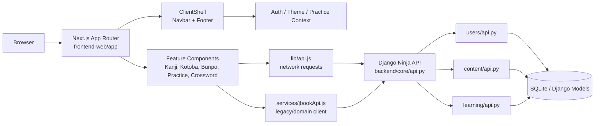
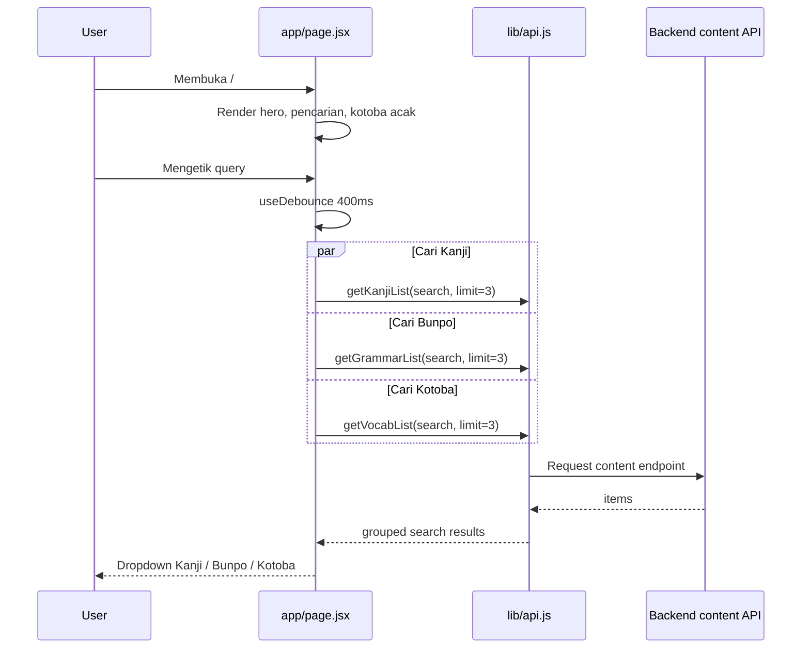
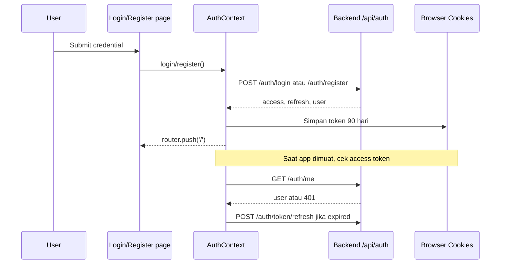

# Arsitektur Web JBook

Dokumen ini memetakan arsitektur frontend Next.js, route, alur data, autentikasi, dan fitur lintas aplikasi.

Terakhir diperbarui: 2026-11

Dokumen ini menjelaskan arsitektur aktual aplikasi web JBook, alur dari halaman Home sampai fitur detail, serta file yang menjadi pemilik setiap tanggung jawab. Frontend berada di `frontend-web/` dan backend Django berada di `backend/`.

## 1. Gambaran Umum



### Prinsip utama

- **Route-first:** setiap halaman publik berada di `frontend-web/app/**/page.jsx`.
- **Shell global:** `frontend-web/app/layout.jsx` memasang provider, toast, announcement popup, dan `ClientShell`.
- **Feature component:** UI yang dipakai ulang dikelompokkan di `frontend-web/components/`.
- **State lintas halaman:** autentikasi, tema, dan status latihan memakai React Context; state TTS memakai Zustand.
- **Data access terpusat:** endpoint konten melewati `frontend-web/lib/api.js` dan meminta data dari backend.
- **Backend modular:** API dipisah menjadi router `auth`, `content`, `learning`, dan `admin`.

## 2. Entry Point dan Shell Global

| Tanggung jawab | File | Peran |
|---|---|---|
| Root HTML, metadata, provider | [frontend-web/app/layout.jsx](../../frontend-web/app/layout.jsx) | Memasang `ThemeProvider`, `AuthProvider`, `PracticeProvider`, `ClientShell`, `ToastContainer`, dan announcement popup. |
| Navbar/footer conditional | [frontend-web/components/common/ClientShell.jsx](../../frontend-web/components/common/ClientShell.jsx) | Menampilkan `Navbar` dan `Footer`; route `/admin` sengaja tanpa shell publik. |
| Navigasi utama | [frontend-web/components/common/Navbar.jsx](../../frontend-web/components/common/Navbar.jsx) | Menu desktop/mobile, status login, dashboard, admin, logout, dan konfirmasi keluar latihan. |
| Footer publik | [frontend-web/components/common/Footer.jsx](../../frontend-web/components/common/Footer.jsx) | Link Kanji, Kotoba, Bunpo, Latihan, dan copyright. |
| Tema | [frontend-web/context/ThemeContext.js](../../frontend-web/context/ThemeContext.js) | Menyimpan pilihan tema `light`/`dark` di localStorage dan memasang class `dark` pada `document.documentElement`. |
| Auth | [frontend-web/context/AuthContext.js](../../frontend-web/context/AuthContext.js) | Login, register, refresh JWT, cek `/auth/me`, logout, reset password, dan cookie token. |
| Status latihan | [frontend-web/context/PracticeContext.js](../../frontend-web/context/PracticeContext.js) | Menyimpan `isPracticing` untuk mencegah navigasi tanpa konfirmasi. |
| Notifikasi | [frontend-web/app/layout.jsx](../../frontend-web/app/layout.jsx) + `react-toastify` | Toast global, termasuk styling, auto-close, progress bar, dan posisi default. |

## 3. Alur Halaman Home

Entry point Home adalah [frontend-web/app/page.jsx](../../frontend-web/app/page.jsx).



File pendukung Home:

- [frontend-web/app/page.jsx](../../frontend-web/app/page.jsx): hero, debounced search, hasil pencarian, kotoba acak, text-to-speech, copy.
- [frontend-web/lib/api.js](../../frontend-web/lib/api.js): `getKanjiList`, `getGrammarList`, `getVocabList`.
- [frontend-web/components/common/Navbar.jsx](../../frontend-web/components/common/Navbar.jsx): navigasi keluar dari Home.

## 4. Peta Route Frontend

### Publik dan pembelajaran

| Route | File pemilik | Fitur |
|---|---|---|
| `/` | [frontend-web/app/page.jsx](../../frontend-web/app/page.jsx) | Home, pencarian lintas konten, kotoba acak, dan informasi JBook. |
| `/privacy-security` | [frontend-web/app/privacy-security/page.jsx](../../frontend-web/app/privacy-security/page.jsx) | Privasi, keamanan akun, dan kontrol pengguna. |
| `/login` | [frontend-web/app/login/page.jsx](../../frontend-web/app/login/page.jsx) | Login dan link privasi. |
| `/register` | [frontend-web/app/register/page.jsx](../../frontend-web/app/register/page.jsx) | Registrasi dan link privasi. |
| `/forgot-password` | [frontend-web/app/forgot-password/page.jsx](../../frontend-web/app/forgot-password/page.jsx) | Permintaan reset password. |
| `/reset-password` | [frontend-web/app/reset-password/page.jsx](../../frontend-web/app/reset-password/page.jsx) | Konfirmasi password baru. |
| `/kana` | [frontend-web/app/kana/page.jsx](../../frontend-web/app/kana/page.jsx) | Referensi hiragana/katakana. |
| `/kanji` | [frontend-web/app/kanji/page.jsx](../../frontend-web/app/kanji/page.jsx) | Daftar, filter, dan kartu Kanji. |
| `/kanji/[level]/[slug]` | [frontend-web/app/kanji/[level]/[slug]/page.jsx](../../frontend-web/app/kanji/%5Blevel%5D/%5Bslug%5D/page.jsx) | Detail Kanji berdasarkan level dan slug. |
| `/kotoba` | [frontend-web/app/kotoba/page.jsx](../../frontend-web/app/kotoba/page.jsx) | Daftar dan filter kosakata. |
| `/kotoba/[id]` | [frontend-web/app/kotoba/[id]/page.jsx](../../frontend-web/app/kotoba/%5Bid%5D/page.jsx) | Detail kosakata dan relasi Kanji. |
| `/bunpo` | [frontend-web/app/bunpo/page.jsx](../../frontend-web/app/bunpo/page.jsx) | Daftar tata bahasa. |
| `/bunpo/[id]` | `frontend-web/app/bunpo/[id]/page.jsx` <!-- TODO: verifikasi path --> | Rute legacy yang disebut di dokumen sumber; file implementasi tidak ditemukan pada audit. |
| `/bunpo/[level]/[slug]` | [frontend-web/app/bunpo/[level]/[slug]/page.jsx](../../frontend-web/app/bunpo/%5Blevel%5D/%5Bslug%5D/page.jsx) | Detail grammar berdasarkan level dan slug, termasuk konten editorial pilot. |
| `/bunpo/add` | [frontend-web/app/bunpo/add/page.jsx](../../frontend-web/app/bunpo/add/page.jsx) | Pengiriman saran tata bahasa. |
| `/blog` | [frontend-web/app/page.jsx](../../frontend-web/app/page.jsx) | Daftar blog. |
| `/blog/[slug]` | [frontend-web/app/blog/[slug]/page.jsx](../../frontend-web/app/blog/%5Bslug%5D/page.jsx) | Detail blog dan share. |
| `/doukai` | [frontend-web/app/doukai/page.jsx](../../frontend-web/app/doukai/page.jsx) | Daftar bacaan. |
| `/doukai/[id]` | [frontend-web/app/doukai/[id]/page.jsx](../../frontend-web/app/doukai/%5Bid%5D/page.jsx) | Detail bacaan dan soal. |

### Latihan dan game

| Route | File pemilik | State/component utama |
|---|---|---|
| `/practice` | [frontend-web/app/practice/page.jsx](../../frontend-web/app/practice/page.jsx) | Konfigurasi dan runner latihan. |
| `/practice/custom` | [frontend-web/app/practice/custom/page.jsx](../../frontend-web/app/practice/custom/page.jsx) | Daftar modul custom. |
| `/practice/custom/[id]` | [frontend-web/app/practice/custom/[id]/page.jsx](../../frontend-web/app/practice/custom/%5Bid%5D/page.jsx) | Mengerjakan modul custom. |
| `/tts` | [frontend-web/app/tts/page.jsx](../../frontend-web/app/tts/page.jsx) | Crossword Kanji/Hiragana. |
| `/dashboard` | [frontend-web/app/dashboard/page.jsx](../../frontend-web/app/dashboard/page.jsx) | Ringkasan progres. |
| `/dashboard/data` | [frontend-web/app/dashboard/data/page.jsx](../../frontend-web/app/dashboard/data/page.jsx) | Export/import data lokal. |
| `/dashboard/history` | [frontend-web/app/dashboard/history/page.jsx](../../frontend-web/app/dashboard/history/page.jsx) | Riwayat latihan. |
| `/dashboard/kakitori` | [frontend-web/app/dashboard/kakitori/page.jsx](../../frontend-web/app/dashboard/kakitori/page.jsx) | Analisis dikte. |
| `/dashboard/levels` | [frontend-web/app/dashboard/levels/page.jsx](../../frontend-web/app/dashboard/levels/page.jsx) | Analisis akurasi level. |
| `/dashboard/mistakes` | [frontend-web/app/dashboard/mistakes/page.jsx](../../frontend-web/app/dashboard/mistakes/page.jsx) | Daftar kesalahan. |

### Detail Bunpo

Route [frontend-web/app/bunpo/[level]/[slug]/page.jsx](../../frontend-web/app/bunpo/%5Blevel%5D/%5Bslug%5D/page.jsx) mengambil catalog dan detail grammar dari backend, mencari pola berdasarkan level dan slug database (dengan pemetaan judul lama sebagai fallback), lalu menormalkan data melalui [frontend-web/lib/bunpo-schema.js](../../frontend-web/lib/bunpo-schema.js). Jika database belum memiliki editorial sections, pilot di [frontend-web/data/bunpo-sections-pilot.js](../../frontend-web/data/bunpo-sections-pilot.js) tetap menjadi fallback; sections yang sudah tersimpan di database diprioritaskan. UI detail dirender oleh [frontend-web/components/bunpo/BunpoDetailUI.jsx](../../frontend-web/components/bunpo/BunpoDetailUI.jsx).

Detail editorial memakai satu alur konten tanpa card wrapper per section. Section dipisahkan border atas dan memiliki ID anchor yang stabil: `fungsi-utama`, `pola-kalimat`, `contoh-kalimat`, `perbandingan`, `nuansa`, `penjelasan-inti`, `kesalahan-umum`, `tanya-jawab`, `latihan-mini`, dan `peta-materi`. Navbar section hanya menampilkan section yang memiliki isi, sticky di bawah navbar global (`top-16`), dan section memakai `scroll-mt-28` agar judul tidak tertutup saat navigasi hash.

Pola non-pilot yang tidak mempunyai section editorial tidak menampilkan navbar tersebut. Konten legacy tetap memakai `explanation`, bagian sumber, dan `sentences`. Detail mengikuti pilihan tema global `light`/`dark`.

### Penyimpanan dan import Bunpo

Model `Grammar` di [backend/content/models.py](../../backend/content/models.py) menyimpan field legacy (`title`, `structure`, `explanation`, `chapter`, `jlpt_level`, `sentences`) serta `slug` unik nullable, `sections` JSON nullable, dan `tags` JSON. Migration `0027_grammar_sections_grammar_slug_grammar_tags` menambahkan field editorial tersebut. [backend/content/grammar_relations.py](../../backend/content/grammar_relations.py) menyertakan `slug`, `sections`, dan `tags` pada serializer publik, sehingga route detail dapat merender konten hasil import.

Halaman [frontend-web/app/admin/bunpo/page.jsx](../../frontend-web/app/admin/bunpo/page.jsx) memasang [frontend-web/app/admin/bunpo/BunpoImportPanel.jsx](../../frontend-web/app/admin/bunpo/BunpoImportPanel.jsx) untuk input satu materi atau bulk melalui JSON/file. Browser memeriksa bentuk array, field wajib, struktur `sections`, dan key yang tidak dikenal sebelum mengirim Bearer token ke `POST /api/content/grammar/bulk-import`.

Endpoint berada di [backend/content/api.py](../../backend/content/api.py). `BunpoImportSchema` dan schema section Pydantic menolak extra keys dan tipe yang salah. Validasi dilakukan pada seluruh batch sebelum transaksi; jika ada error, response 422 memuat detail per index dan tidak ada record yang ditulis. Batch valid dibatasi 500 item, memerlukan staff/superuser, lalu memakai `update_or_create` berdasarkan `slug` di dalam satu transaksi. Serializer admin dan publik sama-sama mengembalikan field editorial.

## 5. Arsitektur Fitur TTS

TTS memiliki dua lapisan: halaman/layout dan engine puzzle.

| File | Tanggung jawab |
|---|---|
| [frontend-web/app/tts/page.jsx](../../frontend-web/app/tts/page.jsx) | Memilih layar menu atau game dan merakit `ScoreBoard`, `CrosswordGrid`, `CluePanel`, `GameControls`, `CompletionModal`. |
| [frontend-web/components/crossword/LevelSelector.jsx](../../frontend-web/components/crossword/LevelSelector.jsx) | Memilih mode Kanji/Hiragana dan memulai game. Level tidak lagi ditampilkan sebagai selector. |
| [frontend-web/stores/gameStore.js](../../frontend-web/stores/gameStore.js) | Fetch pool, state game, input, hint, skor, completion, reset, dan submit progres. |
| [frontend-web/utils/gridGenerator.js](../../frontend-web/utils/gridGenerator.js) | Graph kata, connected component, pemilihan seed, backtracking, bounds, crossing, choice bank. |
| [frontend-web/components/crossword/CrosswordGrid.jsx](../../frontend-web/components/crossword/CrosswordGrid.jsx) | Render grid, navigasi sel, bank pilihan Kanji, dan toast petunjuk keyboard. |
| [frontend-web/components/crossword/CrosswordCell.jsx](../../frontend-web/components/crossword/CrosswordCell.jsx) | Satu kotak, nomor, focus, input keyboard, state benar/salah. |
| [frontend-web/components/crossword/CluePanel.jsx](../../frontend-web/components/crossword/CluePanel.jsx) | Petunjuk mendatar/menurun dan text-to-speech. |
| [frontend-web/components/crossword/GameControls.jsx](../../frontend-web/components/crossword/GameControls.jsx) | Hint berbayar dan modal konfirmasi keluar. |
| [frontend-web/components/crossword/ScoreBoard.jsx](../../frontend-web/components/crossword/ScoreBoard.jsx) | Skor dan jumlah jawaban; streak sudah dihapus. |
| [frontend-web/components/crossword/CompletionModal.jsx](../../frontend-web/components/crossword/CompletionModal.jsx) | Ringkasan selesai dan auto-close/reset. |
| [frontend-web/utils/gridGenerator.test.mjs](../../frontend-web/utils/gridGenerator.test.mjs) | Regression test graph, crossing, reading, distractor, dan arah kata. |

### Data TTS

1. `startGame` mengambil Kotoba melalui `getVocabList` dan, untuk mode Kanji, daftar Kanji melalui `getKanjiList`.
2. Jika daftar Kanji kosong/tidak lengkap, karakter Kanji dari Kotoba dipakai sebagai fallback.
3. Generator membangun graph berdasarkan karakter jawaban.
4. Connected component terbesar dipakai sebagai pool.
5. Seed dengan degree tinggi dicoba beberapa kali.
6. DFS/backtracking mencari posisi valid dengan crossing nyata.
7. Puzzle menerima 5–10 kata; kata searah tidak boleh memakai sel yang sama.
8. Choice bank diacak dan berisi jawaban plus distractor.

## 6. Data Access Frontend

### `frontend-web/lib/api.js`

File utama akses data frontend. Menangani:

- `getKanjiList`, `getKanjiDetail`, visibility Kanji.
- `getGrammarList`, `getGrammarDetail`.
- `getVocabList`, `getVocabDetail`.
- Practice questions, submit/reset/export/import progres.
- Blog, Doukai, TTS, announcement, custom module, suggestion.
- Network requests dan normalisasi response; materi dan respons API tidak disediakan offline.

### `frontend-web/services/jbookApi.js`

Client class `JBookAPI` yang masih dipakai untuk beberapa alur domain:

- `login`, `register`, `getProfile`.
- Kotoba dan random kotoba.
- Submit practice dan analytics.
- Custom modules dan admin custom modules.
- Bearer token dari cookie `access_token`.

Untuk fitur baru, pilih satu data client secara konsisten. Jangan menambah endpoint yang sama ke kedua client tanpa alasan kompatibilitas.

### Akses data

Fitur konten dan latihan meminta data langsung dari backend. Respons API dan hasil latihan tidak disimpan sebagai cache offline, dan hasil latihan pengguna terautentikasi harus berhasil dikirim ke server.

Alur import Bunpo dari admin:

```mermaid
sequenceDiagram
    participant Admin as Admin /admin/bunpo
    participant Panel as BunpoImportPanel
    participant API as POST /api/content/grammar/bulk-import
    participant DB as Grammar database

    Admin->>Panel: Input satu data atau pilih/tempel JSON array
    Panel->>Panel: Parse JSON dan validasi key/sections
    Panel->>API: Kirim array dengan Bearer token
    API->>API: Pastikan staff/superuser
    API->>API: Validasi semua item sebelum transaksi
    alt Semua valid
        API->>DB: update_or_create per slug dalam transaksi
        DB-->>API: Hasil upsert
        API-->>Panel: count dan status per record
    else Ada item invalid
        API-->>Panel: HTTP 422 dengan error per index; tidak ada write
    end
```

## 7. Backend API

### Router utama

[backend/core/urls.py](../../backend/core/urls.py) memasang Django admin dan `/api/`. [backend/core/api.py](../../backend/core/api.py) memasang router:

| Prefix | Router | Tanggung jawab |
|---|---|---|
| `/api/auth` | [backend/users/api.py](../../backend/users/api.py) | Register, login, refresh/me, reset password. |
| `/api/content` | [backend/content/api.py](../../backend/content/api.py) | Kanji, vocab, grammar, blog, TTS, Doukai, announcements, custom modules. |
| `/api/learning` | [backend/learning/api.py](../../backend/learning/api.py) | Generate practice, Minna, TTS, Doukai, submit/analytics/reset/export/import. |
| `/api/admin` | [backend/content/admin_api.py](../../backend/content/admin_api.py) | CRUD admin dan upload/export content. |

### Model data utama

| Model | File | Fungsi |
|---|---|---|
| `User` | [backend/users/models.py](../../backend/users/models.py) | Akun dan identitas pengguna. |
| `Kanji` | [backend/content/models.py](../../backend/content/models.py) | Karakter, level, bacaan, stroke, contoh. |
| `Vocab` | [backend/content/models.py](../../backend/content/models.py) | Kotoba, reading, meaning, relasi Kanji. |
| `Grammar` | [backend/content/models.py](../../backend/content/models.py) | Field legacy Bunpo, slug publik unik nullable, editorial sections JSON nullable, tags JSON, dan contoh kalimat. Migration `0027` menambah field editorial tersebut. |
| Learning models | [backend/learning/models.py](../../backend/learning/models.py) | Progres, jawaban, analytics, dan modul latihan. |

### Middleware dan konfigurasi

- [backend/core/settings.py](../../backend/core/settings.py): installed apps, database, JWT-related config, CORS, cache, static/media, email.
- `django_ratelimit`: proteksi rate limit endpoint tertentu.
- `ninja_jwt`: autentikasi Bearer JWT.
- `corsheaders`: CORS frontend/backend.
- `whitenoise`: static file serving.
- SQLite default: `backend/db.sqlite3`.

## 8. Alur Autentikasi



File pemilik:

- [frontend-web/context/AuthContext.js](../../frontend-web/context/AuthContext.js): state sesi dan refresh token.
- [frontend-web/app/login/page.jsx](../../frontend-web/app/login/page.jsx): form login.
- [frontend-web/app/register/page.jsx](../../frontend-web/app/register/page.jsx): form register.
- [frontend-web/app/forgot-password/page.jsx](../../frontend-web/app/forgot-password/page.jsx): request reset.
- [frontend-web/app/reset-password/page.jsx](../../frontend-web/app/reset-password/page.jsx): konfirmasi reset.
- [backend/users/api.py](../../backend/users/api.py): endpoint auth.

## 9. Admin dan Proteksi Navigasi

- Admin route berada di `frontend-web/app/admin/` dan memiliki [frontend-web/app/admin/layout.jsx](../../frontend-web/app/admin/layout.jsx).
- `/admin/bunpo` menyediakan daftar/visibilitas Bunpo dan form satuan serta bulk JSON import.
- `ClientShell` tidak menampilkan Navbar/Footer publik pada `/admin`.
- Akses API admin dilindungi `AdminAuth()` pada `backend/content/admin_api.py`.
- `POST /api/content/grammar/bulk-import` memakai autentikasi Bearer dan mewajibkan `is_staff` atau `is_superuser`; seluruh batch divalidasi sebelum transaksi upsert.
- Panel import berada di [frontend-web/app/admin/bunpo/BunpoImportPanel.jsx](../../frontend-web/app/admin/bunpo/BunpoImportPanel.jsx); form satuan dan upload/tempel JSON berbagi validasi dan endpoint bulk yang sama.
- Endpoint bulk berada di [backend/content/api.py](../../backend/content/api.py), memakai schema Pydantic `extra="forbid"`, maksimum 500 item, error per indeks, serta satu transaksi untuk semua `update_or_create` berdasarkan slug.
- Serializer [backend/content/grammar_relations.py](../../backend/content/grammar_relations.py) mengirim `slug`, `sections`, dan `tags` ke katalog/detail publik. Route detail memprioritaskan data database; `BUNPO_SECTIONS_PILOT` tetap fallback sementara untuk record tanpa sections.
- `Navbar` menampilkan link Admin hanya untuk email/staff yang sesuai.
- Konfirmasi navigasi latihan ditangani oleh [frontend-web/components/common/ConfirmationModal.jsx](../../frontend-web/components/common/ConfirmationModal.jsx) dan `PracticeContext`.

## 10. Security dan Privacy Surface

- Token auth disimpan di cookie `access_token`/`refresh_token` oleh `AuthContext`.
- Request API menambahkan `Authorization: Bearer ...` melalui `frontend-web/lib/api.js` atau `frontend-web/services/jbookApi.js`.
- Backend menggunakan JWT, CSRF middleware, CORS config, rate limit, password validators, dan X-Frame-Options.
- Data konten tidak disimpan untuk penggunaan offline; statistik tamu tetap tersimpan lokal sebagai riwayat akun tamu.
- Halaman penjelasan pengguna: [frontend-web/app/privacy-security/page.jsx](../../frontend-web/app/privacy-security/page.jsx).

Konfigurasi deployment harus menimpa secret dan credential default melalui environment variable. Jangan memasukkan secret baru ke source control.

## 11. Konvensi Perubahan

### Menambah halaman baru

1. Buat `frontend-web/app/<route>/page.jsx`.
2. Tentukan apakah halaman membutuhkan `use client`.
3. Gunakan komponen feature yang sudah ada sebelum membuat duplikasi.
4. Tambahkan link di Navbar/Footer bila memang halaman publik.
5. Tambahkan loading dan error state untuk request jaringan.
6. Jalankan lint dan build.

### Menambah endpoint

1. Tambahkan handler pada router backend yang sesuai.
2. Tambahkan schema response/request.
3. Tambahkan wrapper di `frontend-web/lib/api.js` atau `frontend-web/services/jbookApi.js`.
4. Tambahkan loading dan error behavior pada UI.
5. Tambahkan test atau smoke check.

### Validasi minimum

```bash
cd frontend-web
npm run lint
npm run test:grid
npm run build
```

## 12. Risiko dan Catatan Teknis

- `frontend-web/lib/api.js` dan `frontend-web/services/jbookApi.js` memiliki tanggung jawab yang tumpang tindih; konsolidasikan secara bertahap agar tidak ada dua kontrak API.
- Browser lama yang pernah memakai PWA akan membersihkan service worker dan cache lamanya saat aplikasi berikutnya dibuka.
- Beberapa komponen masih memiliki styling light/dark yang berbeda; jaga keduanya saat mengubah UI bertema.
- Route publik, dashboard, dan admin memiliki layout yang berbeda; perubahan pada `frontend-web/app/layout.jsx` berdampak luas.
- State game TTS dipersist oleh Zustand; ketika mengubah shape `gameState`, pertimbangkan migration/versioning storage.

## Penilaian SOLID

Bagian ini menggabungkan evaluasi arsitektur frontend yang sebelumnya berada di dokumen terpisah. Penilaian adalah kondisi yang teramati, bukan target kepatuhan.

Frontend web utama berada di `frontend-web/`. `mobile-app/` saat ini masih berisi starter screen Expo, sehingga belum memiliki cukup alur atau modul untuk dinilai setara.

**Kesimpulan:** frontend web sudah memakai beberapa pola yang selaras dengan SOLID, seperti komponen bersama, context untuk state lintas halaman, dan utility terpisah. Namun penerapannya belum konsisten. Beberapa page dan provider masih menggabungkan presentasi, workflow, dan akses jaringan. SOLID adalah alat bantu desain, bukan checklist yang harus dipaksakan ke setiap komponen React.

| Prinsip | Status saat ini | Bukti dan batasan |
|---|---|---|
| **S — Single Responsibility** | Sebagian | Ada komponen bersama seperti `frontend-web/components/auth/AuthLayout.jsx` dan context sempit seperti `frontend-web/context/PracticeContext.js`. Sebaliknya, `frontend-web/context/AuthContext.js` mengelola pemulihan sesi, refresh token, cookie, login/register, reset password, profil, poin TTS, dan navigasi. Halaman admin Kotoba juga merangkai state UI, fetch, hapus, ekspor CSV, pemeriksaan duplikat, dan visibilitas level. |
| **O — Open/Closed** | Sebagian, belum eksplisit | Utility dan komponen bersama dapat digunakan ulang. Pada contoh halaman admin Kotoba, perubahan workflow seperti sumber data atau aturan ekspor masih mendorong perubahan pada page yang sama; belum ada batas ekstensi yang konsisten untuk semua fitur. Ini kesimpulan dari contoh yang ditinjau, bukan seluruh halaman. |
| **L — Liskov Substitution** | Belum cukup bukti | Frontend React lebih banyak memakai composition dan hooks daripada pewarisan kelas. Belum ada dasar untuk menyatakan substitusi komponen/implementasi telah dijaga secara sistematis. Nilai kompatibilitas melalui kontrak props dan perilaku komponen, bukan dengan menambah inheritance buatan. |
| **I — Interface Segregation** | Sebagian | Halaman register hanya mengambil operasi `register` dari context, tetapi `frontend-web/context/AuthContext.js` tetap menyediakan banyak operasi akun dalam satu provider. `frontend-web/services/jbookApi.js` menggabungkan endpoint auth, content, learning, dan admin dalam satu client. Tidak setiap consumer memakai semua metode tersebut. |
| **D — Dependency Inversion** | Belum konsisten | Pemisahan akses data sudah ada melalui `frontend-web/lib/api.js` dan `frontend-web/services/jbookApi.js`, tetapi kedua client berjalan berdampingan. AuthContext dan halaman admin Kotoba masih memanggil `fetch` langsung. Akibatnya aturan URL, token, dan penanganan error tidak memiliki satu boundary yang konsisten. |

### Batas Modul Saat Ini

- Route dan halaman berada di `frontend-web/app/`; komponen yang dipakai ulang berada di `frontend-web/components/`.
- State global utama dikelola oleh `AuthContext`, `ThemeContext`, dan `PracticeContext`. State tertentu menggunakan Zustand.
- Akses backend tersebar antara `frontend-web/lib/api.js`, `frontend-web/services/jbookApi.js`, serta pemanggilan `fetch` di beberapa context/page.
- Kontrak API utama berada di backend Django; frontend tetap perlu mengubah response menjadi bentuk yang sesuai untuk tampilan dan workflow.

### Arah Perbaikan Bertahap

1. Untuk endpoint baru, pilih satu client akses data yang aktif dan dokumentasikan pemilik domainnya. Hindari menambahkan endpoint yang sama ke beberapa client.
2. Pindahkan request dan normalisasi response dari page ke modul domain/API yang sudah digunakan fitur tersebut. Page tetap mengatur interaksi layar, bukan detail URL dan token.
3. Pertahankan Context sebagai pemilik state lintas halaman. Pindahkan operasi jaringan atau workflow yang tumbuh besar ke modul auth/API yang terpisah, lalu biarkan Context mengoordinasikan state sesi.
4. Pecah halaman admin ketika perubahan terpisah mulai mengganggu satu sama lain, misalnya query data, operasi mutasi, dan ekspor. Jangan membuat hook atau service baru hanya untuk memindahkan beberapa baris.
5. Pertahankan helper transformasi sebagai fungsi murni dan uji perilakunya. Gunakan komposisi serta kontrak props yang jelas; tambahkan abstraction/interface hanya saat ada kebutuhan nyata untuk beberapa implementasi atau pengujian terisolasi.

## Catatan Konsolidasi

- Dokumen Arsitektur Web JBook dan Arsitektur Frontend dan SOLID telah digabung di sini; isi penilaian SOLID dipertahankan pada bagian di atas.
- `docs/features/frontend-logic-reference.md` berisi detail implementasi yang lebih rinci dan beberapa catatan legacy. Klaim offline/cache di sana bertentangan dengan alur data pada dokumen ini; gunakan implementasi terkini dan tinjau konflik itu sebelum mengubah perilaku.
- Dokumen lama merujuk lima deep-dive yang tidak tersedia di workspace: `SISTEM-RATING-KESALAHAN.md`, `LOGIKA-SARAN-BELAJAR.md`, `LOGIKA-SISTEM-LATIHAN.md`, `LOGIKA-PENGELOLAAN-DATA-LATIHAN.md`, dan `LOGIKA-SISTEM-ADMIN.md`. Isinya tidak direkonstruksi tanpa sumber.
