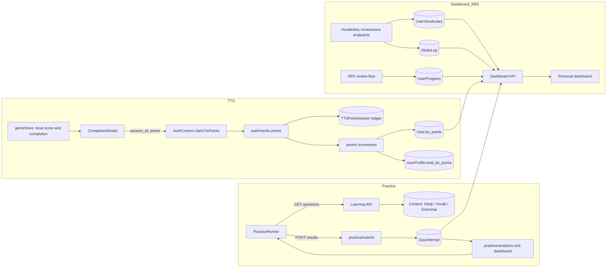

# JBook Data Audit and Insights

Audit date: 2026-11-06. Database: Django `default`, configured as SQLite because `DATABASE_URL` is unset. The audit utility uses ORM reads only and enables SQLite `query_only` mode. No API, model, frontend, or database data was changed.

## Architecture and Data Flow



### Practice / Quiz

`PracticeRunner` builds result objects in the browser and submits `{ results }` to `POST /learning/practice/submit`. The endpoint creates `QuizAttempt` rows in bulk. Persisted state is per question: user, one content FK, `is_correct`, optional `answer_given`, `mode`, and timestamp. There is no practice session ID, completion flag, total score, or session duration in `QuizAttempt`; the separate `StudySession` table is not linked to attempts.

The frontend also sends display-oriented fields such as `character`, `correct_answer`, `correct_meaning`, and `level`; these are not in `AnswerSchema` and are not persisted. The API accepts up to 500 results per request.

**Important data caveat:** the submit endpoint deletes prior wrong attempts for an item after a correct answer makes its historical accuracy reach at least 80%. Thus the table is not a complete immutable answer history, and accuracy computed from current rows can be biased upward. In this snapshot, 407 of 420 attempts also have empty/null `answer_given`.

### TTS / Crossword

`gameStore` calculates score in client state (for example, correct cell entry adds points; errors and hints subtract points). A new `ttsSessionId` is generated when a game starts. When the game completes, `CompletionModal` calls `AuthContext.claimTtsPoints(sessionId, score)`, which posts to `/auth/me/tts-points`.

The backend validates points to `0..5000`, then atomically `get_or_create`s `TTSPointSession` by `(user, session_id)`. Only the first insert increments both `User.tts_points` and `UserProfile.total_tts_points`. This makes retries with the *same* session ID idempotent and avoids double-counting that request. It does not validate the score against server-calculated gameplay, nor prevent a client from submitting a new session ID with another permitted score. That is an integrity risk, not evidence that cheating occurred in this database.

`TTSPointSession` has no `is_completed` field. It records a point claim, not every started/abandoned game, so completion rate cannot be derived.

**Payload mismatch to investigate:** the crossword store separately calls `submitPracticeResults` with objects containing `type`, `character`, `is_correct`, `score`, and `created_at`, but no required `question_id`. `AnswerSchema` requires `question_id`; these requests do not match the practice API schema and are likely rejected before saving. TTS points are claimed separately through the completion modal, so this mismatch can lose crossword practice history without necessarily preventing a TTS point claim.

### Dashboard / SRS

The dashboard aggregates `QuizAttempt`, `StudyLog`, `StudySession`, `UserVocabulary`, and `UserProfile`. SRS state is represented in `UserVocabulary` (box, status, next review, review count) and generic `UserProgress` (SRS stage and review timestamps). `StudyLog` records daily vocabulary additions/reviews. In the audited database all these activity/SRS tables are empty, so this snapshot cannot support SRS retention or review effectiveness analysis.

## Data Quality and Counts

| Table / check | Result | Interpretation |
|---|---:|---|
| Users / UserProfile | 4 / 4 | All current users have profiles |
| `content.Vocab` | 7,638 | Content table is populated |
| `QuizAttempt` | 420 | Historical question attempts |
| `StudySession` | 0 | No session-duration records |
| `StudyLog` | 0 | No dashboard daily activity rows |
| `UserVocabulary` / `UserProgress` | 0 / 0 | No saved vocabulary or SRS progress |
| `TTSPointSession` | 0 | No TTS claims to compare |
| Orphan attempt users / targetless attempts | 0 / 0 | No missing user or content link found |
| TTS rows missing user profile / user | 0 / 0 | No orphan TTS rows; the tables are empty |
| Profile total vs. TTS ledger; User total vs. profile | 0 mismatched users / 0 | Consistent in this snapshot; no ledger rows exist |
| StudyLog future / pre-1970 / before account date / zero-item rows | 0 / 0 / 0 / 0 | No StudyLog anomalies; table is empty |
| Future QuizAttempt timestamps | 0 | No future-dated quiz rows |
| Missing/blank `answer_given` | 407 / 420 (96.9%) | Significant loss of answer-detail data |
| Practice modes | `choice`: 420 | No other mode appears in stored rows |
| SRS rows without next-review date / future `last_reviewed` | 0 / 0 | No SRS rows exist |

Foreign keys use cascading deletes, so orphan-user records are also structurally constrained in normal database operation. The audit still checks for them explicitly.

## Metrics Snapshot

| Metric | Result | Notes |
|---|---:|---|
| Active learning-data users, last 7 days | 0 of 4 | Based on quiz, StudyLog, TTS claim, SRS review, or saved vocabulary update |
| Active learning-data users, last 30 days | 0 of 4 | Same event definition |
| Practice attempts, last 30 days | 0 | The 420 stored attempts are older than this window |
| Practice sessions per active user-week | N/A | No recent attempts and no native session ID |
| Questions / duration per practice session | N/A | No recent attempts; `StudySession` is empty and unrelated to attempts |
| Average TTS points per claim | N/A | 0 claims |
| TTS claims over 10,000 points / API limit 5,000 | 0 / 0 | No claims; no evidence of a points spike |
| TTS completion percentage | N/A | No completion flag or denominator in schema |
| Stored-attempt accuracy, Kanji | 94.81% (329/347) | 18 wrong; highest wrong count by item type |
| Stored-attempt accuracy, Grammar | 79.37% (50/63) | 13 wrong; highest error rate at 20.63% |
| Stored-attempt accuracy, Particle | 100% (10/10) | Small sample |
| Stored-attempt accuracy, Vocab / Minna | N/A (0 attempts) | No rows |
| Overall stored-attempt accuracy | 92.62% (389/420) | Likely biased upward by deletion of wrong attempts described above |

“Active” here means a learning-data event, not an authenticated website visit; there is no login/session analytics table in this scope. Practice session averages are intentionally not inferred from old attempts. The audit script can estimate sessions using a 30-minute idle gap once recent attempts exist, but that is only a heuristic.

## Index and Technical Debt Findings

Current database indexes include FK indexes on `QuizAttempt`, `(user, date)` and `(user, activity_type, date)` on `StudyLog`, and the unique `(user, session_id)` TTS constraint. `QuizAttempt.timestamp` has no index; `TTSPointSession.created_at` also has no index. The current model does not define an index for either field.

1. **Add first-class practice sessions.** Introduce a stable session ID, start/end or completion state, and session-level score/count. Link attempts to it. This enables reliable sessions-per-week, duration, completion, and orphan-session metrics instead of timestamp heuristics.
2. **Preserve immutable answer history.** Do not delete wrong attempts when a learner later answers correctly. Keep attempts and calculate mastery as a separate aggregate/projection; otherwise analytics and longitudinal learning history are distorted.
3. **Validate TTS awards server-side.** Client-submitted points are capped but remain client-controlled. Consider a server-issued, one-time game token and server-verifiable score/result, while retaining the existing unique session constraint for idempotency. Reconcile or remove duplicated point counters only after checking compatibility and historical data.
4. **Fix and slim the crossword practice payload.** Align its submit shape with `AnswerSchema` and provide a valid content ID/type; omit presentation fields that the endpoint ignores. Add a request/contract test so a completed crossword cannot silently fail practice-history persistence.
5. **Add indexes only after query-plan measurement.** For the observed per-user analytics filter, test a composite `(user, timestamp)` index on `QuizAttempt`; for global time-window queries test `timestamp` alone if that workload is actually used. Benchmark SQLite locally and the production database separately before adding an index, since every extra index increases write/storage cost.

## Repeatable Audit

From `backend/`:

```bash
python scripts/audit_data.py
```

The script performs read-only aggregate/select queries and enables SQLite `PRAGMA query_only` on its connection. It prints counts and aggregates only, not usernames or answer text. Confirm `DATABASE_URL` points to the intended database before running in another environment.
