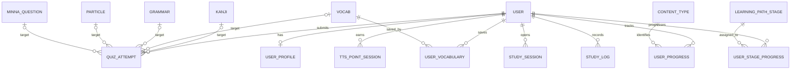
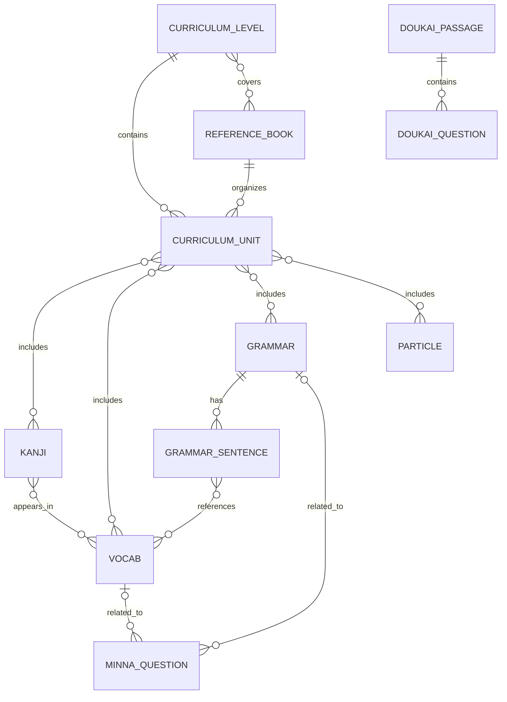

# Relasi Database JBook

Dokumen ini memetakan relasi model Django yang aktif pada backend, terutama domain pengguna, latihan, TTS, dashboard/SRS, dan konten pembelajaran. Sumber utama: `backend/users/models.py`, `backend/learning/models.py`, dan `backend/content/models.py`.

Untuk jumlah baris dan hasil pemeriksaan kualitas data pada snapshot lokal, lihat [Audit Data dan Insight](data_insights.md). Relasi di bawah menjelaskan struktur skema; relasi tidak berarti bahwa baris datanya sudah ada.

## ERD Domain Pengguna dan Pembelajaran

`o|` pada relasi target latihan menandakan bahwa FK target di `QuizAttempt` nullable dan optional. Diagram tidak menyatakan constraint “tepat satu target”: model memiliki lima FK opsional, tetapi tidak memiliki `CheckConstraint` untuk memastikan hanya satu yang diisi. Pemeriksaan snapshot menemukan seluruh 420 attempt memiliki tepat satu target.

`USER_PROGRESS` memakai pasangan `content_type` + `object_id` dan `GenericForeignKey`, bukan FK database langsung ke tabel Kanji/Vocab/Grammar. Karena itu database menjamin relasinya ke `django_content_type`, tetapi tidak menjamin bahwa `object_id` benar-benar menunjuk ke baris konten yang masih ada.

## ERD Konten dan Kurikulum

Catatan relasi konten:

- `CurriculumUnit` memiliki FK wajib ke satu `CurriculumLevel` dan satu `ReferenceBook`; satu level/buku dapat memiliki banyak unit.
- `ReferenceBook` dan `CurriculumLevel` juga memiliki relasi many-to-many tersendiri, terpisah dari unit.
- Kanji, vocab, grammar, dan particle masing-masing dapat ditautkan ke banyak unit kurikulum, dan satu unit dapat berisi banyak item.
- `Vocab`–`Kanji` adalah many-to-many. Data contoh yang disimpan di field JSON seperti `Kanji.examples` bukan relasi FK.
- `GrammarSentence` dimiliki satu grammar melalui FK wajib dan dapat merujuk ke banyak vocab melalui many-to-many.
- `MinnaQuestion` dapat terkait dengan satu grammar dan/atau satu vocab; keduanya nullable dan memakai `SET_NULL` saat konten target dihapus.
- `DoukaiQuestion` selalu dimiliki satu passage. Penghapusan passage menghapus seluruh pertanyaannya (`CASCADE`).

## Relasi, Kardinalitas, dan Aturan Penghapusan

| Model sumber | Relasi | Kardinalitas / batasan | Efek penghapusan |
|---|---|---|---|
| `User` | `UserProfile.user` | One-to-one, wajib; maksimal satu profil per user | `CASCADE` |
| `User` | `TTSPointSession.user` | One-to-many; unik pada pasangan `(user, session_id)` | `CASCADE` |
| `User` | `QuizAttempt.user` | One-to-many | `CASCADE` |
| `QuizAttempt` | `kanji`, `vocab`, `grammar`, `particle`, `minna_question` | Masing-masing FK nullable; tidak ada session FK dan tidak ada constraint tepat-satu-target | `CASCADE` pada target terkait |
| `User` | `StudySession.user` | One-to-many; durasi berasal dari `start_time`/`end_time` | `CASCADE` |
| `User` | `StudyLog.user` | One-to-many; unik per `(user, activity_type, date)` | `CASCADE` |
| `User` + `Vocab` | `UserVocabulary` | Join model; unik per `(user, vocabulary)` | `CASCADE` pada user maupun vocab |
| `User` + `ContentType` + `object_id` | `UserProgress` | Generic relation; index `(content_type, object_id)` | User/ContentType `CASCADE`; target konten tidak memiliki FK cascade langsung |
| `User` + `LearningPathStage` | `UserStageProgress` | Join/progress model; unik per `(user, stage)` | `CASCADE` |
| `CurriculumUnit` | `CurriculumLevel`, `ReferenceBook` | Dua FK wajib per unit | `CASCADE` |
| `GrammarSentence` | `Grammar` | Banyak sentence untuk satu grammar; urutan unik per `(grammar, order)` | `CASCADE` |
| `DoukaiQuestion` | `DoukaiPassage` | Banyak soal untuk satu passage | `CASCADE` |

## Alur Relasi Antar Data

1. **Latihan reguler:** konten menjadi sumber pertanyaan. Setelah pengguna menjawab, satu `QuizAttempt` menyimpan user, hasil benar/salah, jawaban opsional, mode, waktu, dan salah satu target konten. Tidak ada entitas sesi yang mengelompokkan beberapa attempt.
2. **TTS:** satu user memiliki banyak catatan klaim `TTSPointSession`. Nilai agregat juga disalin ke `User.tts_points` dan `UserProfile.total_tts_points`; ketiga penyimpanan ini adalah relasi/denormalisasi yang harus tetap konsisten. Keunikan `(user, session_id)` mendukung idempotensi untuk pengiriman ulang ID sesi yang sama.
3. **Kosakata tersimpan/SRS:** `UserVocabulary` menghubungkan user dengan vocab, menyimpan status, box, tanggal review, dan jumlah review. `StudyLog` merangkum aktivitas per user, jenis aktivitas, dan tanggal; ia tidak menunjuk ke item vocab tertentu.
4. **SRS generik:** `UserProgress` menghubungkan user dengan objek konten menggunakan `ContentType` dan `object_id`. Target tidak ditegakkan FK oleh database.
5. **Dashboard:** statistik dapat mengagregasi `QuizAttempt`, `StudyLog`, `StudySession`, `UserVocabulary`, `UserProgress`, profil, dan catatan TTS. Karena sumber-sumber ini berbeda, angka dashboard bukan satu tabel transaksi tunggal.

## Kondisi Data Snapshot Audit

Pada snapshot SQLite yang diperiksa tanggal 2026-11-06, ada 4 user/profile dan 7.638 vocab. Terdapat 420 `QuizAttempt`; tabel `StudySession`, `StudyLog`, `TTSPointSession`, `UserVocabulary`, dan `UserProgress` kosong. Semua attempt memiliki satu user dan tepat satu target konten. Dengan demikian relasinya tersedia di skema, tetapi relasi data aktivitas/SRS/TTS belum terisi pada database lokal tersebut.

## Catatan Integritas

- `QuizAttempt` mengizinkan semua target nullable. Untuk penggunaan normal satu target dipilih berdasarkan jenis soal, tetapi integritas “tepat satu target” baru menjadi konvensi aplikasi.
- `UserProgress` dapat menjadi dangling reference bila baris konten dihapus; audit integritas perlu memeriksa `object_id` per `ContentType` bila tabel mulai digunakan.
- Poin TTS memiliki ledger sesi dan dua counter agregat. Pembaruan endpoint bersifat transaksional dan unik per session ID, tetapi nilai skor bersumber dari client.
- Hasil submit practice dapat menghapus jawaban salah terdahulu; relasi attempt yang tersisa bukan riwayat jawaban immutable.
- Snapshot kosong pada tabel sesi/SRS/TTS tidak membuktikan model tidak dipakai di deployment lain. Jalankan audit pada database target dengan `DATABASE_URL` yang benar sebelum mengambil keputusan operasional.