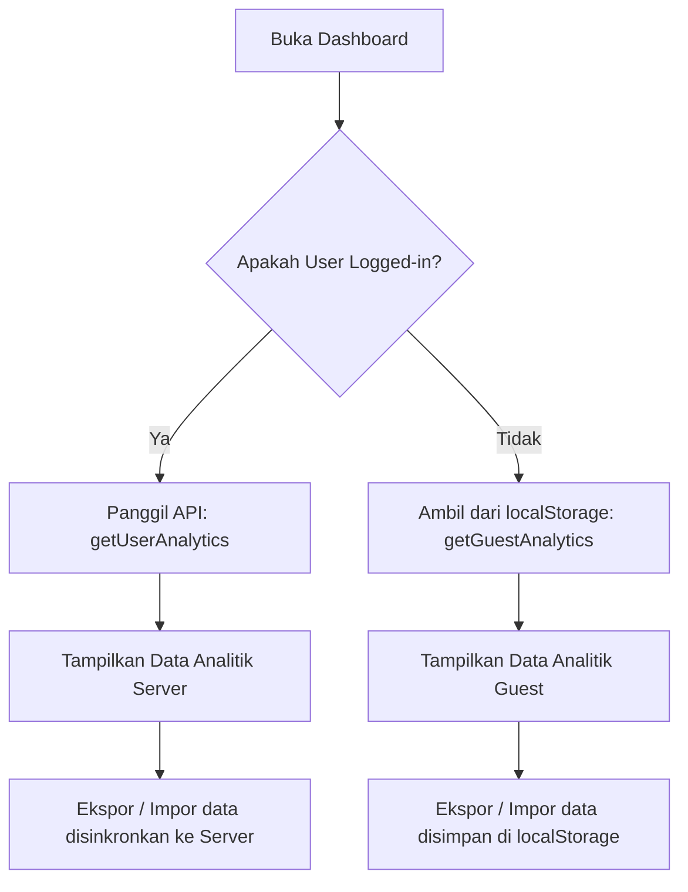

# Dokumentasi Dashboard Pengguna (User Dashboard)

Dokumen ini menjelaskan struktur, pembagian halaman, alur data, serta detail teknis mengenai Dashboard Pengguna pada platform JBook.

---

## 1. Arsitektur & Pembagian Halaman

Dashboard pengguna yang sebelumnya berada dalam satu halaman besar kini dibagi menjadi beberapa sub-halaman fungsional di bawah folder `/app/dashboard/` untuk meningkatkan keterbacaan kode, kenyamanan performa rendering, serta pengalaman navigasi pengguna:

| Halaman | Rute (Route) | Deskripsi Utama | Komponen / Widget Utama |
| :--- | :--- | :--- | :--- |
| **Ringkasan (Overview)** | `/dashboard` | Gambaran umum aktivitas dan performa belajar pengguna. | Banner Tamu, Kartu Akurasi Rata-rata & Total Soal, Saran Belajar & Insight Dinamis. |
| **Akurasi Level JLPT** | `/dashboard/levels` | Rincian performa akurasi belajar berdasarkan level JLPT (N5 - N1). | Grid Akurasi Level, Progress bar interaktif. |
| **Analisis Kakitori** | `/dashboard/kakitori` | Statistik latihan dikte (kakitori) untuk menguji kemampuan pendengaran. | Sesi dikte, akurasi dikte, breakdown level, tips latihan pendengaran. |
| **Analisis Kesalahan** | `/dashboard/mistakes` | Analisis item yang paling sering salah dijawab beserta sebaran kategori materi. | Tabel top salah (Kanji/Kotoba/Bunpo) terintegrasi dengan modal detail, sebaran kategori salah. |
| **Riwayat Jawaban** | `/dashboard/history` | Log seluruh jawaban latihan yang pernah dimasukkan oleh pengguna. | Tabel log jawaban, filter tipe, pagination. |
| **Manajemen Data** | `/dashboard/data` | Fitur ekspor/impor data pencapaian untuk kebutuhan pencadangan & sinkronisasi perangkat. | Ekspor file JSON, Impor file JSON dengan validasi skema. |

---

## 2. Navigasi & Tata Letak (Layout)

Navigasi antar halaman dashboard dikelola secara tersentralisasi melalui **`dashboard/layout.jsx`**. Tata letak ini bertindak sebagai pembungkus (*wrapper*) yang menjaga:
- Konten navigasi tetap berada di atas (atau di samping pada layar lebar).
- Efek visual tab aktif berbasis penandaan rute Next.js (`usePathname`).
- Keberlangsungan state global (seperti tema, otentikasi) tanpa re-render berlebihan saat berpindah halaman dashboard.

---

## 3. Alur Pengambilan & Sinkronisasi Data

Pengambilan data analitik di semua halaman dashboard mengikuti metode hibrida berdasarkan status login pengguna:

### Penanganan Mode Tamu (Guest)
- Data latihan disimpan pada key `guest_practice_analytics` di `localStorage`.
- Jika pengguna memutuskan untuk masuk/mendaftar, disediakan banner ajakan untuk memindahkan data lokal tersebut ke server database.

### Manajemen Ekspor/Impor
- **Ekspor**: Mengompilasi seluruh riwayat (termasuk data kakitori) ke dalam format file JSON standard.
- **Impor**:
  - Melakukan validasi format JSON.
  - Untuk pengguna masuk, mengirimkan payload JSON ke API Server (`importPracticeData`).
  - Untuk Guest, melakukan penulisan ulang ke `localStorage` setelah memastikan atribut minimal (seperti `kakitori_stats` dan `total_attempts`) sudah valid.

---

## 4. Dashboard Personal dan Roadmap

Widget dashboard personal ditampilkan di halaman overview untuk pengguna yang login. Komponen berada di `frontend-web/app/dashboard/Dashboard.jsx`; halaman induknya adalah `frontend-web/app/dashboard/page.jsx`. Widget ini terpisah dari analitik latihan overview yang mendukung guest.

### Endpoint statistik

`GET /api/learning/dashboard/stats` didefinisikan di `backend/learning/views.py` dengan Django Ninja dan `JWTAuth()`. Router view digabungkan ke `learning/api.py`, lalu dipasang pada prefix `/api/learning` melalui `core/api.py` dan `core/urls.py`.

Endpoint hanya membaca data milik `request.auth` dan mengembalikan:

- `username`, `total_tts_points`, dan `tts_games_played`.
- `total_saved` serta jumlah vocab berstatus `mastered`, `learning`, dan `new`.
- Aktivitas belajar harian 30 hari dan breakdown jenis aktivitas.
- `roadmap`, dengan `stage_code`, `title`, `is_available`, dan `completion_percentage`.

Poin diambil dari `UserProfile.total_tts_points` dengan fallback ke `User.tts_points`; sesi game dihitung dari relasi `User.tts_point_sessions`. Progress model disimpan sebagai `UserStageProgress.completion_percent`, lalu diserialisasi sebagai `completion_percentage`. Stage `beta` dianggap belum tersedia dan ditampilkan “Coming Soon”.

### Tampilan dan kegagalan request

Komponen mengirim token sebagai `Authorization: Bearer <token>`, memakai `API_URL` dari `frontend-web/lib/api.js`, dan meminta data tanpa cache. UI menangani status loading, 401/akses, kegagalan umum, dan menyediakan aksi coba lagi. Access token utama aplikasi disimpan pada cookie oleh `AuthContext`; pembacaan localStorage di widget hanya fallback migrasi lama.

Detail file terkait, migration, test, dan langkah melanjutkan perbaikan variasi seed TTS tersedia di [AI Handoff](ai-handoff.md).
